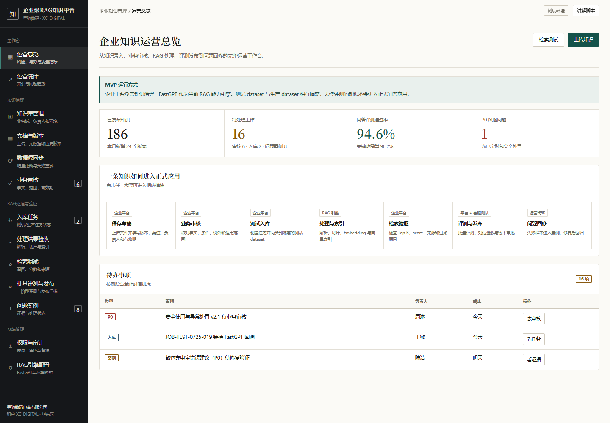
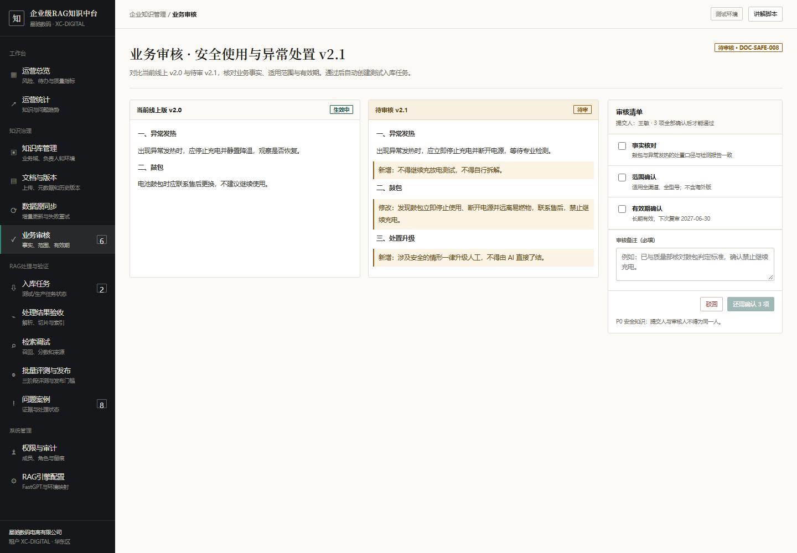
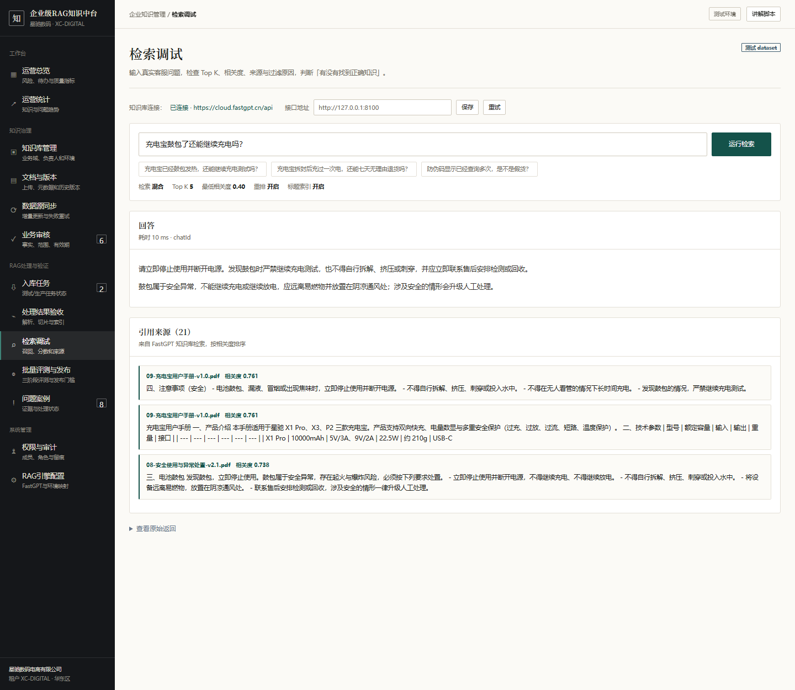

# 企业级 RAG 知识中台 · 产品设计 + 可运行原型

一个面向电商售后场景的知识治理中台：把「知识能不能用、谁能用、效果如何」从「模型怎么答」里拆出来，
用审核、版本、双环境隔离和三阶段评测，让每一条上线知识都可追溯。



## 这是什么

- **产品层**：13 个模块的高保真原型（知识库、文档与版本、业务审核、入库任务、结果验收、检索调试、批量评测与发布、问题案例、权限审计、RAG 引擎配置等）
- **工程层**：一个本地连接层，把原型里的「检索调试」接到真实的 FastGPT 知识库，回答带引用、可回溯到文档与相关度
- **数据层**：20 份虚构的售后知识文档（保修、退换、安全、渠道、物流、发票、协议、故障排查），用于评测与演示

> 所有企业名、型号、文档内容均为虚构，仅用于演示；仓库不含任何真实业务数据与 API Key。

## 三个页面

| 业务审核 | 检索调试（已连接知识库） |
|---|---|
|  |  |

## 架构

```
┌─────────────┐   fetch    ┌──────────────┐   Bearer Key   ┌─────────────┐
│  原型 HTML   │ ─────────▶ │ 局部连接层 proxy │ ─────────────▶ │  FastGPT 知识库 │
└─────────────┘            └──────────────┘                └─────────────┘
        回答 + 引用 ◀──────────────────────────────────────────────┘
```

- 原型是静态文件，直接调 FastGPT 会跨域、且会把 Key 暴露在浏览器里
- `connector/proxy.py` 只做三件事：托管页面、转发请求、把 Key 留在服务端

## 快速开始

```bash
# 1. 配置环境变量（Windows PowerShell）
$env:FG_BASE = "https://cloud.fastgpt.cn/api"   # 自建版改成 http://localhost:3000/api
$env:FG_KEY  = "fastgpt-你的应用Key"

# 2. 启动连接层（需 Python 3.7+，无第三方依赖）
python connector/proxy.py

# 3. 浏览器打开
#    http://127.0.0.1:8100
```

只想看界面：直接双击 `prototype/console.html`（纯静态，不需要连接层）。

## 目录

```
prototype/
  console.html               13 模块高保真原型（静态）
  console-connected.html     同上 + 真实 FastGPT 调用
connector/
  proxy.py                   本地连接层（标准库，零依赖）
  start.bat                  Windows 一键启动（需填 Key）
knowledge/                   20 份虚构售后知识文档（DOCX/PDF/CSV/TXT）
docs/
  PRD.md                     产品需求文档
  eval-set-20.xlsx           20 条评测集（含 P0 用例与判定标准）
  experiment-log.xlsx        7 天实验记录表（部署、切片、检索、评测、接口）
screenshots/                 界面截图
```

## 已实现 / 未实现

| 已实现 | 未实现 |
|---|---|
| 13 模块原型与交互（审核通过/驳回、验收、评测、发布阻断） | 真实后端与数据库（原型数据为静态） |
| 原型 → 连接层 → FastGPT 的完整问答链路 | 多租户与 SSO |
| 回答带引用、显示来源文档与相关度 | 切片参数自动调优 |
| 20 条评测集与判定标准 | 自动化评测流水线 |

## 设计取舍

1. **平台管治理，引擎管效果**：不自研解析器、Embedding、向量库与模型网关，把资源放在审核、版本与发布门槛上。
2. **测试 / 生产双 dataset 物理隔离**：未验证的知识物理上进不了生产，而不是靠权限配置兜底。
3. **审核与评测分离**：审核判「内容对不对」（业务负责），评测判「AI 能不能用」（产品负责），失败才能归因。
4. **发布门槛**：5 条冒烟 → 40 条正式 → 200 条全量回归 → 线下审批，P0 用例必须全过。

## 数据与隐私

- 文档内容为虚构示例，企业与型号均不指向真实公司
- 仓库不含任何 API Key；连接层通过环境变量读取
- 若复用本仓库的文档，请同样标注为虚构示例

## 致谢

界面与流程的初始灵感来自公开分享的「企业级 RAG 知识库平台」原型与 PRD，
本仓库为独立重写实现，仅用于学习与作品集展示，不包含原作者的原始文件。

## License

MIT（代码部分）。`knowledge/` 下的文档为虚构示例，可自由用于学习。
